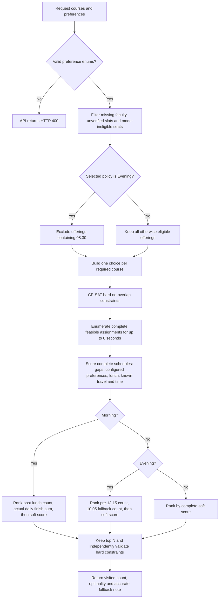

# Timetable optimization behavior

## Recovered requirements and constraint classes

### Hard scheduling constraints

- Every requested course must appear exactly once; a course is never silently dropped.
- Each selected offering must have a verified slot and a faculty identity. Combined slots expand to all atomic meetings.
- No two selected courses may overlap in any expanded meeting.
- `LIVE_REGISTRATION` requires known, positive seats. `PLANNING` may retain full or unknown-seat offerings.
- A student's exact selected offering must remain selected and pass the same slot, seat-mode, and full-timetable clash validation.
- In the selected `evening` policy, offerings containing an 08:30 meeting are excluded. This is the explicit Evening boundary; it is not a general early-class preference.

The independent final validator checks course coverage, offering identity, verified slots, registration-mode seat eligibility, Evening's 08:30 boundary, and clashes. It does not reject a timetable for a soft preference.

### Selected scheduling policy

`timePreference` (`morning`, `evening`, or `balanced`) is separate from registration `mode` (`PLANNING` or `LIVE_REGISTRATION`). Morning and Evening policy tiers rank eligible complete schedules before the general soft score:

- **Morning:** minimize meetings starting at or after 13:15; then minimize the sum of verified actual end times for each teaching day's last class; then compare the complete soft score. Afternoon classes remain eligible. The fallback note reports when returned alternatives include post-lunch meetings.
- **Evening:** exclude offerings containing 08:30; then minimize meetings before 13:15; then minimize 10:05 fallback meetings, which puts an 11:40 fallback ahead of 10:05; then compare the complete soft score. The fallback note describes returned alternatives that use an earlier period.
- **Balanced:** use the complete soft score without Morning/Evening policy tiers.

These selected-mode policy tiers are a separate ranking layer. They do not turn soft preferences into feasibility rules. Enumeration retains the best `topN` across complete feasible assignments, not just a truncated CP-SAT candidate pool.

### Soft preferences

- **Day Scholar:** prefer every teaching day to finish by 18:00 and prefer earlier daily finishes. A later class remains eligible and receives a lower score. The score uses the verified end time of each day's final class; it does not optimize campus-day count.
- **Lunch:** when `mandatoryLunch` is enabled, prefer the lunch-adjacent period to remain free. Using both 11:40 and 13:15 on the same day incurs an additional score cost. The name is retained for API compatibility; it is never a hard constraint. Day Scholar and lunch are independent.
- **Compactness:** `maxGap` changes gap penalties. `maxGap: 0` increases the penalty for genuine gaps; it never rejects a timetable.
- **Preferred day off:** lower score if the selected day has classes; the schedule remains eligible.
- **Venue travel:** `walkingPriority` only scores known distances between confirmed physical buildings. Unknown mappings remain unknown; unknown travel cannot reject or favor a schedule.
- **Time preference:** outside the separate Morning/Evening policy tiers, its score is part of the general soft score.

The retired “Avoid the earliest classes” control is ignored for compatibility. Saturday is not penalized without a recovered active user preference. Faculty ratings, difficulty, and attendance preferences remain excluded from optimization.

## Score weights and penalty boundaries

`compute_score` retains its existing top-level weights:

| Score component | Weight |
|---|---:|
| Official-period gap compactness | 30% |
| Configured preference match | 25% |
| Verified venue travel | 20% |
| Lunch | 15% |
| Time preference | 10% |

The weights are normalized over the components present. Travel is omitted when disabled or when no verified transition can be scored. Within the preference-match component, only selected preferences participate: a selected preferred day and Day Scholar finish score are averaged when both are enabled; an unset preference contributes no penalty. When Day Scholar is the only selected preference in this component, it receives the full 25% component weight. Morning/Evening policy tiers rank before this weighted score as described above.

The Day Scholar subscore is computed per teaching day from verified period end times. Finishes by 18:00 score from 0.9 to 1.0, with earlier finishes slightly preferred. Finishes after 18:00 score below 0.9 and decline linearly to 0 at the latest official finish. The Day Scholar setting contributes through the configured preference-match component; it cannot override hard constraints or make an otherwise-valid schedule infeasible.

Gap ordering comes from the seven unique periods in `backend/data/slots.csv`. Consecutive official periods have no artificial gap; omitted periods between classes count as genuine gaps.

## Search and optimality

CP-SAT enumerates clash-free complete assignments for up to eight seconds. The callback scores each full assignment and retains up to the requested top N. `feasibleCount` is the number visited, not the number returned. It is the total feasible count only when `optimizationOptimal: true`. If enumeration times out, the optimizer returns the best assignments visited so far and reports global optimality as unproven.

## Venue travel limits

Only confirmed physical `FacultyOption.building` codes and directed edges present in `backend/data/buildings.csv` contribute. Room strings are not parsed into building codes by the scoring function. Unknown transitions are counted separately; travel score is `null` when no transition is mapped. If only some transitions are mapped, the score covers those known transitions and exposes the unknown count. Unknown mappings are not assigned zero minutes, and no global travel optimum is claimed. Current venue/building mappings have not been independently verified for completeness or provenance.

## Compatibility fields with unresolved semantics

`maxClassesPerDay` remains accepted by the request model, but the optimizer does not enforce it and the current planner has no control for it. Older API documentation describes it as a hard cap but gives a different default than the current model; available project history does not resolve whether a combined offering should count as one class or multiple periods. It is therefore not silently imposed as a new hard rule.

`avoidEarlyMorning` and `avoidSaturday` remain accepted for older clients but are ignored. This preserves request compatibility without applying preferences that were removed or are not currently selected in the planner.

## Actual implementation flow

