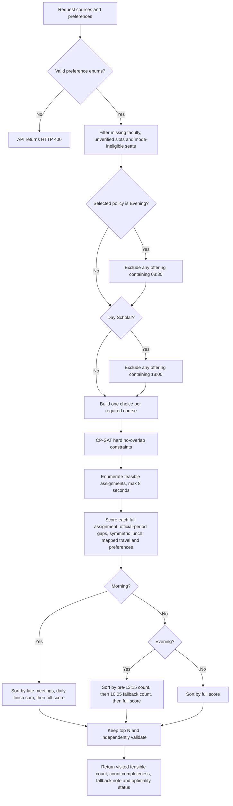

# Timetable optimization behavior

## Constraints and preferences

### Hard constraints

- Every requested course must appear once.
- Every selected slot must be present in the verified slot map; no unverified slot can bypass clash checking.
- Courses cannot overlap in any expanded meeting.
- LIVE_REGISTRATION requires known, positive seats. PLANNING retains full or unknown-seat offerings.
- A Day Scholar cannot have the 18:00 period.
- Evening policy excludes an offering if any expanded meeting starts at 08:30.

These are eligibility rules. The final independent validator checks required-course coverage, offering identity, slot verification, seat eligibility, Day Scholar cutoff, Evening's 08:30 restriction, and clashes.

### Selected scheduling policy

`timePreference` is one of `morning`, `evening`, or `balanced` and is independent from `mode` (`PLANNING` or `LIVE_REGISTRATION`).

- Morning candidates are compared first by fewest meetings starting at or after 13:15, then by the sum of the verified end times of each class day’s final meeting, then by the complete soft score. Later classes remain eligible. `policyFallbackNote` says only that at least one returned alternative includes a post-lunch meeting; it does not imply every alternative needs fallback.
- Evening candidates cannot include 08:30. Among the remaining feasible assignments, the optimizer first minimizes all meetings before 13:15, then minimizes 10:05 meetings (so 11:40 is preferred as the earlier fallback), then applies the complete soft score. `policyFallbackNote` says only that at least one returned alternative uses an earlier-than-13:15 fallback.
- Balanced uses the complete soft score without a morning/evening tier.

### Soft preferences

The full score used for ranking includes gap compactness (`maxGap`), preferred free day, Saturday and early-class preferences, Day Scholar day/finish preference, lunch, known venue travel, and time preference. Gap order is derived from the seven unique official periods in `backend/data/slots.csv`; consecutive periods have zero gap, and omitted periods between meetings count as genuine gaps. Lunch is independent of Day Scholar and remains soft; it never rejects a valid timetable. Each occupied 11:40 or 13:15 period gets the same soft cost, and using both on one day adds a further same-day cost. Turning `mandatoryLunch` off removes all lunch penalties.

## Search and optimality

CP-SAT enumerates clash-free assignments and evaluates the complete timetable score as each assignment is found. It retains the best `topN` according to the selected policy tier followed by the full score; it does not rank a bounded CP-SAT objective shortlist afterward. The search limit is eight seconds. `feasibleCount` is the number of feasible assignments visited, not the number of returned timetables. It is the total feasible count only when `optimizationOptimal: true`, which means CP-SAT completed enumeration. If the time limit interrupts enumeration, the API returns the best assignments found so far with `optimizationOptimal: false`; global best and total feasible count are then unproven.

Morning and Evening are lexicographic policy priorities above soft score. In Morning, post-lunch meeting count and daily finish-time sum are the first two ranking fields. In Evening, pre-13:15 meeting count and then 10:05 fallback count are the first two ranking fields. Other soft preferences are combined by the score weights in `compute_score`.

## Venue travel limits

Only `FacultyOption.building` codes in `DataStore.CONFIRMED_PHYSICAL_CODES` and directed edges present in `backend/data/buildings.csv` are used. A room string is not parsed into a building code by the scoring function. A transition without a confirmed mapping contributes to `travelUnknownTransitions`; travel score is `null` when no transition is mapped. If some transitions are mapped, the score covers only those known transitions and the known/unknown counts expose incomplete coverage. Unknown mappings are not assigned zero minutes, and no global travel optimum is claimed. Current venue/building mappings have not been independently verified for completeness or provenance.

## Lunch preference

“Keep the lunch period free” is a soft score preference for every student. `dayScholar` affects only the Day Scholar cutoff and score; it does not enable, disable, or clear `mandatoryLunch`.

## Actual implementation flow

